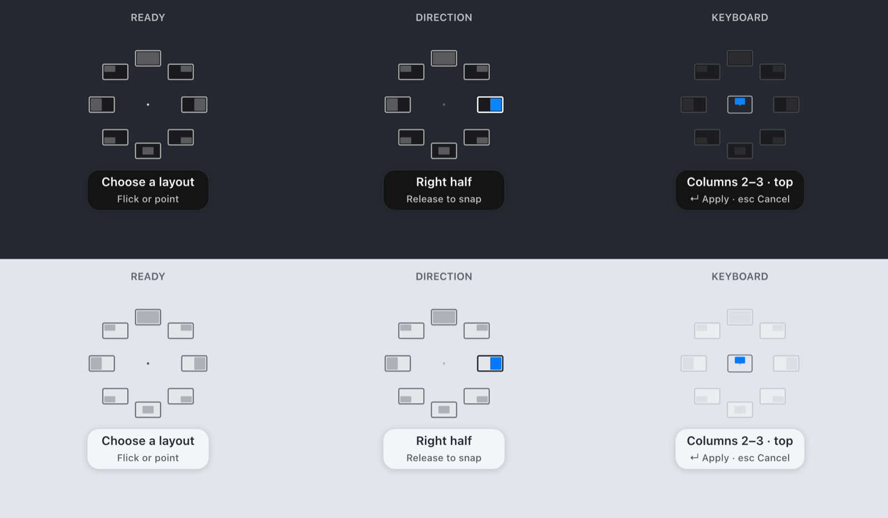
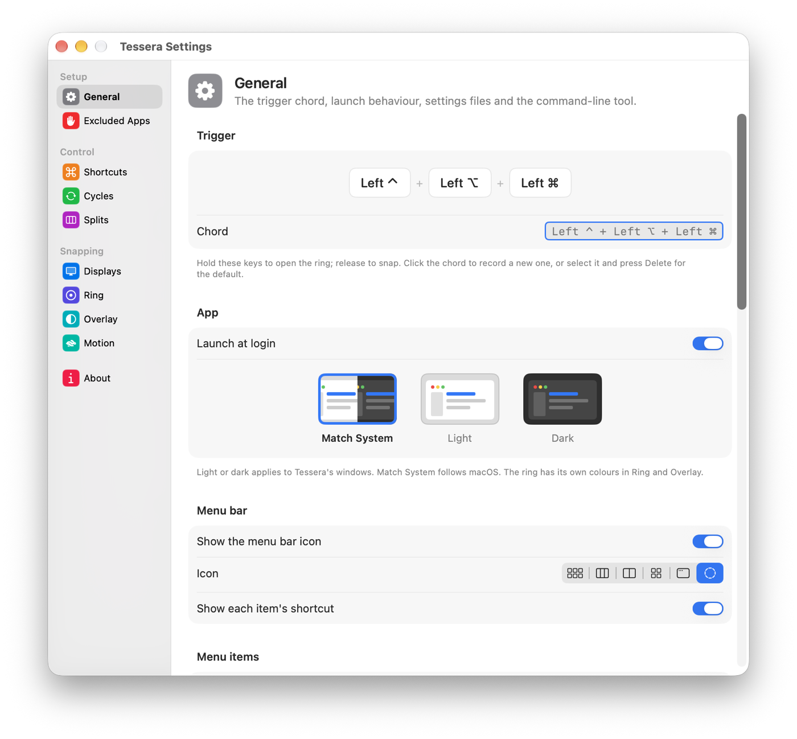
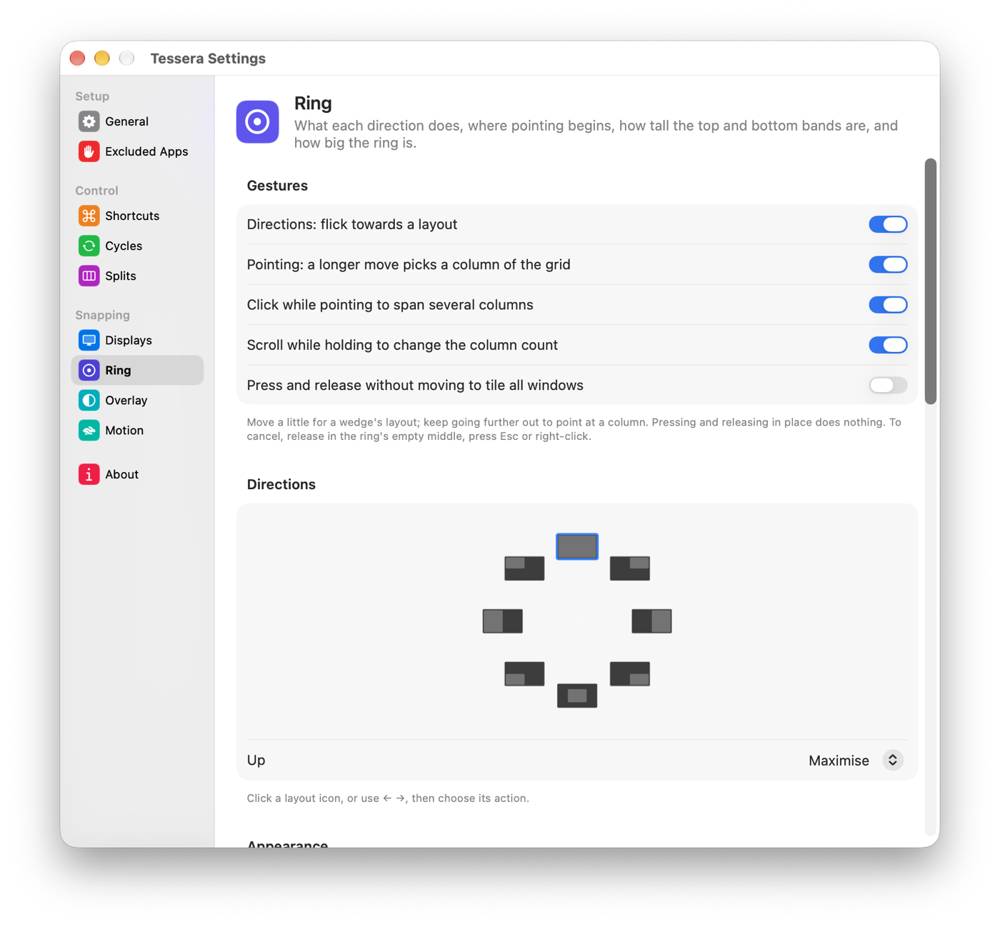

# Tessera

A window manager for macOS that fits its grid to each display. Hold a key chord, flick or point, and the front window snaps into place.



Tessera is free, open source (GPL-3.0) and in public beta. It needs macOS 15 Sequoia or later.

## Features

- **Flick or point.** Hold the trigger chord (Left Control + Left Option + Left Command by default). A short flick picks a layout from the ring: halves, quarters, maximise, centre. Move further and point at a column instead.
- **A grid per display.** Column counts come from each display's usable size. A 14" MacBook gets halves and quarters; a 49" 32:9 ultrawide starts at five columns. Scroll while holding to change the count, and Tessera remembers it per display. Click while pointing to span several columns.
- **A clear preview.** Before you let go, Tessera shows the window in its new spot with its size, dims the windows it will cover and outlines where it was.
- **Tile every window.** Tile All Windows and Tile Evenly arrange a whole display at once. Tessera learns the splits you adjust by hand and reuses them.
- **Undo and explain.** ⌃⌥Z undoes any move. **What Just Happened?** in the menu bar says what the last move did and why.
- **Keyboard first.** Every action has a hotkey, and the open ring works with arrow keys, numbers, Return and Esc.
- **Automation.** A command-line tool, a `tessera://` URL scheme, AppleScript and Shortcuts actions all run the same commands.
- **Yours to change.** Trigger, hotkeys, cycles, column counts, colours, themes and motion are all settings. Export and import them as one JSON file.

| General settings | Ring settings |
|---|---|
|  |  |

The [User Guide](docs/USER-GUIDE.md) covers every setting with examples.

## Install

1. Download the latest `Tessera-….zip` from [Releases](https://github.com/prabeshbhetwal/tessera/releases) and move `Tessera.app` to Applications.
2. The beta is not notarised by Apple yet, so macOS blocks the first launch. Open it once, then go to System Settings › Privacy & Security and choose **Open Anyway**.
3. Grant Accessibility when Tessera asks. That's the only required permission.

Tessera checks for updates in the background and installs them from the menu bar.

## Permissions

- **Accessibility (required):** to read, move and resize other apps' windows.
- **Screen Recording (optional):** for the window snapshot in the preview. Without it, the preview shows a plain outline.

## Privacy

Tessera has no analytics, no accounts and no telemetry. Settings stay on your Mac.

- **Update checks** fetch a feed from GitHub (`raw.githubusercontent.com`). GitHub sees your IP address and Tessera's version, as with any download.
- **Window snapshots** are drawn on your Mac for the preview and discarded. They are never saved or sent.

## Keyboard

**While the ring is open:**

| Key | Action |
|---|---|
| ← / → | Move one column |
| ⇧← / ⇧→ | Extend the span |
| ↑ / ↓ | Bottom, full or top band |
| 1–9 | Jump to that column |
| = / − | Change the column count |
| Tab / ⇧Tab | Next or previous display |
| Return | Apply |
| Esc | Cancel |

**Hotkeys** (default bindings; change them in Settings › Shortcuts):

| Key | Action |
|---|---|
| ⌃⌥← / ⌃⌥→ | Cycle: half, edge column, two columns |
| ⌃⌥↑ | Maximise |
| ⌃⌥↓ | Centre |
| ⌃⌥1–9 | Column 1 to 9 |
| ⌃⌥= / ⌃⌥− | One more or one fewer column |
| ⌃⌥N / ⌃⌥P | Next or previous display |
| ⌃⌥T | Tile All Windows |
| ⌃⌥Z | Undo Last Move |
| ⌃⌥/ | What Just Happened? |
| ⌃⌥⌘, | Open Settings |

In Settings, ⌘1–9 and ⌘0 switch panes and every control is reachable with Tab.

## Automation

Install the command-line tool from Settings › General › Advanced. It links `tessera` into `~/.local/bin`.

```bash
tessera apply --cols 2-4 --band top     # columns 2 to 4, top half
tessera action leftHalf
tessera cycle left
tessera columns --set 6 --display 2
tessera move next
tessera remember                        # remember the current split for Tile All Windows
tessera displays --json
tessera settings export ~/tessera.json
```

- **URL scheme:** `open "tessera://apply?cols=2-4&band=top"`. URLs can't read or write files.
- **AppleScript:** `tell application "Tessera" to apply columns "2-4" band top`
- **Shortcuts and Spotlight:** search for "Tessera" in the Shortcuts app.

## Roadmap

| | Status |
|---|---|
| Ring, display grids, preview, tiling and learned splits | In beta |
| Keyboard control and automation | In beta |
| Drag to snap | Planned |
| Saved layouts that restore when you dock | Planned |
| Moving windows across displays and Spaces | Planned |

## Build from source

Requirements: macOS 15, Xcode 16 or later and [XcodeGen](https://github.com/yonaskolb/XcodeGen) (`brew install xcodegen`).

```bash
swift test --package-path Packages/TesseraCore --scratch-path ~/Library/Caches/tessera-build/core-main
app="$(scripts/build-app.sh)"
open "$app"
```

`build-app.sh` generates the Xcode project, builds into `~/Library/Caches/tessera-build/` (codesign fails inside iCloud-synced folders) and prints the app's path. A build signed ad hoc may need Accessibility granted again after each rebuild.

Checks that never move your windows:

```bash
bash scripts/verify-automation.sh
bash scripts/verify-ring-rendering.sh /tmp/tessera-ring-preview.png
bash scripts/verify-app-packaging.sh "$app"
```

### Project layout

- `Packages/TesseraCore`: pure Swift logic with no AppKit, covered by unit tests. Grid sizing, selection, the trigger state machine, the preview model, commands and settings.
- `Tessera/`: the macOS app. `Services/` (event tap, displays, Accessibility, snapshots), `Overlay/` (ring and preview panels), `UI/` (settings and onboarding), `Automation/` and `Intents/`.
- `scripts/`: build, release and verification scripts.

## Licence

Tessera is free software under the [GNU General Public License v3.0](LICENSE), with no warranty. Bundled components are listed in [Third-party notices](THIRD-PARTY-NOTICES.md). To report a security issue privately, see [SECURITY.md](SECURITY.md).
